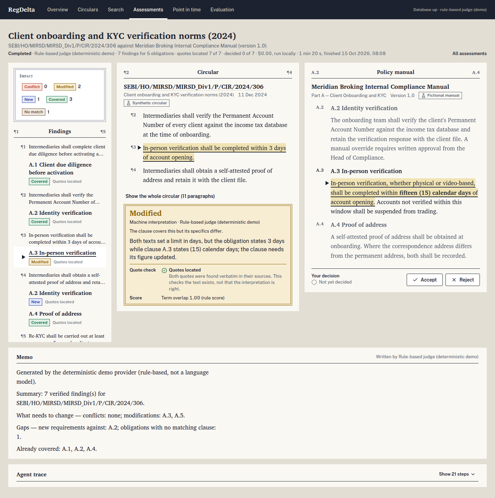

# RegDelta

RegDelta compares a regulatory circular with a firm's compliance manual,
obligation by obligation, and shows an analyst the evidence for every finding:
the exact passage in the circular, the clause in the manual, the machine's
interpretation, whether the quotes were found in their sources, and the
analyst's own decision.

> A technical prototype for a single user on one machine, not legal advice.
> The demo corpus is **synthetic** SEBI-style circulars and the manual is a
> **fictional** broker's; both are labelled as such throughout the interface.



## The workflow

```
circular PDF → paragraphs with character offsets → obligations
  → retrieval of candidate manual clauses (dense + lexical, fused, reranked)
  → impact judged per obligation and clause → quotes located in both sources
  → analyst accepts or rejects; the decision is stored with its time
```

Each finding keeps three things apart:

1. **Quote status.** *Quotes located* means both quoted passages were found
   verbatim at stored offsets; it proves the text exists, not that the reading
   is right. *Quote not located* findings are kept, marked unverified, and show
   the quote that could not be found. *No quote to check* means retrieval found
   no clause close enough, so nothing was judged.
2. **Machine interpretation.** The impact (conflict, modified, new
   requirement, already covered, no match) and rationale, labelled with the
   judge that produced them. A model's own score is shown as "model-stated,
   uncalibrated", never as a confidence percentage.
3. **Analyst decision.** Pending, accepted or rejected, saved only when the
   server confirms it.

## Run it (Linux)

Needs Docker, Python 3.11 and Node 20.

```bash
cp .env.example .env     # the defaults run the demo; no API key needed
make setup               # Postgres (pgvector) container, backend/.venv from the lockfile, npm ci
make db seed             # create + migrate the database; build the synthetic demo data
make dev-api             # terminal 1: API on http://127.0.0.1:8000
make dev-web             # terminal 2: app on http://127.0.0.1:5173
```

`make seed` generates 300 synthetic circulars, ingests them, builds the
citation and supersession graph, indexes the fictional manual, embeds
everything, extracts obligations with the rule extractor, and writes the
retrieval gold set. The first run downloads two small models from Hugging Face
(`BAAI/bge-small-en-v1.5`, `BAAI/bge-reranker-base`).

The default judge is **deterministic**: a rule-based stand-in that makes no
network call, costs nothing, and is labelled "Rule-based judge (deterministic
demo)" wherever its output appears. For real model judgements set
`LLM_PROVIDER=groq` (or `anthropic`) and the matching key in `.env`; without a
key the app still runs and says assessments are unavailable and why.

Then open **Circulars**, pick one, choose **Start assessment**, and follow the
run into the workspace. [docs/demo-script.md](docs/demo-script.md) is a
five-minute guided tour.

## Checks

```bash
make check      # ruff, format check, mypy, backend tests, frontend typecheck/tests/build
make e2e-db e2e # Playwright against the real API and a disposable database
make eval       # the research evaluation (slow: see below)
```

CI (`.github/workflows/ci.yml`) runs the fast gates, a hybrid-retrieval
regression gate on a small corpus, and the end-to-end suite; the full
evaluation is a separate, manual workflow.

## Evaluation, briefly

Retrieval is measured in four modes (dense, lexical, hybrid, hybrid + rerank)
on one fixed query manifest, with refusal reported beside ranking quality and
per-query latency measured warm. The labels come from the synthetic corpus's
citation graph, so they are template-derived, not human judgements, and the
numbers say nothing about performance on real SEBI circulars.

On the 120-query sample (2026-10-15), reranking raised Recall@10 from 0.650
(hybrid) to 0.758, paired difference +0.108 (95% interval +0.059 to +0.164).
It refused 15 of 15 out-of-scope questions and none of the 135 answerable
ones. The cost is a median of 56 s per query on a 2015 laptop CPU, against
47 ms for hybrid. Fusing dense with lexical did not beat lexical alone on
this corpus.
[docs/evaluation.md](docs/evaluation.md) explains the method and its limits;
[docs/evaluation-results.md](docs/evaluation-results.md) holds the generated
tables with full provenance.

A small real-source corpus (18 official SEBI documents, fetched by
`python -m ingestion.scrape_sebi`, not redistributed) and an annotation
workflow are in place for independent labels. Its candidate labels were
drafted by a model and remain provisional; human review is pending, so no
real-corpus accuracy is claimed.

## Documentation

- [docs/architecture.md](docs/architecture.md): layers, data flow, the offset
  contract, retrieval, the agent and its limits, the live trace, security.
- [docs/evaluation.md](docs/evaluation.md): what is measured, how, and what
  it does not show.
- [docs/limitations.md](docs/limitations.md): what RegDelta does not do.
- [DESIGN.md](DESIGN.md) and [PRODUCT.md](PRODUCT.md): the interface's design
  system and product brief.
- [docs/reading-guide.md](docs/reading-guide.md): the source in reading order.
- [docs/interview-narratives.md](docs/interview-narratives.md): two
  engineering stories from this repository.
- [docs/maintenance/regdelta-cleanup-ledger.md](docs/maintenance/regdelta-cleanup-ledger.md):
  the 2026-10 repair, item by item, with its evidence.

## Stack

FastAPI, SQLAlchemy 2 (async, psycopg 3), Alembic, PostgreSQL 16 with
pgvector, sentence-transformers on CPU, LangGraph, an MCP server (fastmcp);
React 18, TypeScript, Vite, Tailwind, TanStack Query, React Router, Recharts,
Lucide; Vitest and Playwright.

## Licence

MIT, see [LICENSE](LICENSE). The bundled fonts (Charis SIL, Public Sans) are
under the SIL Open Font License. Official SEBI documents are fetched from
sebi.gov.in by the user and are not part of this repository.
